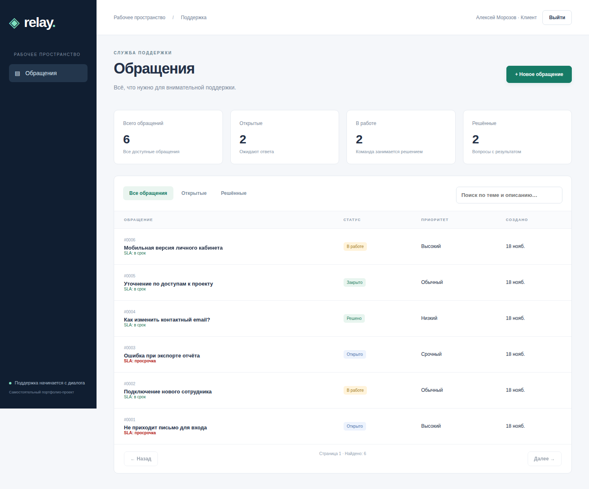
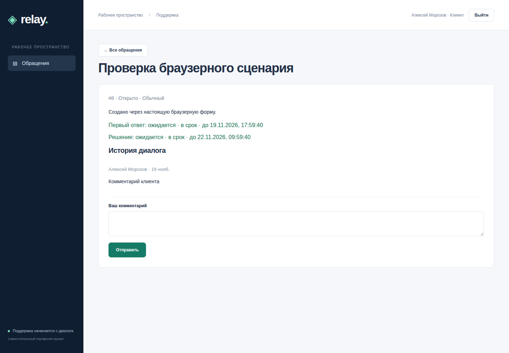
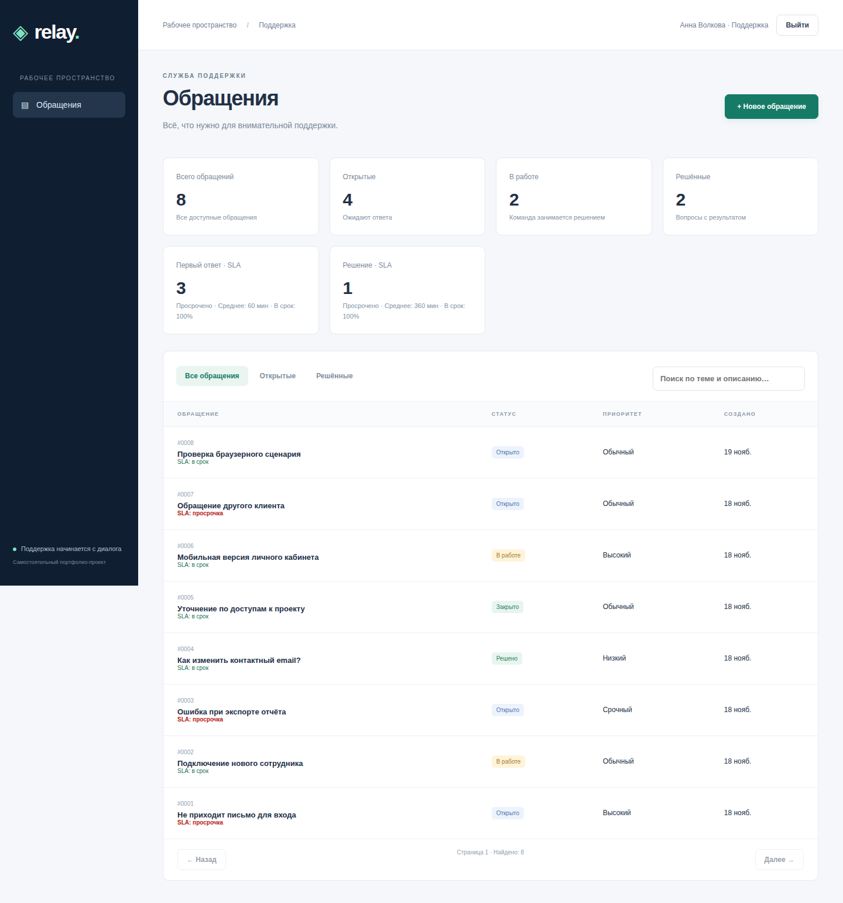

# Relay — HelpDesk

Учебный сервис поддержки: обращения клиентов, переписка, статусы и контроль SLA. Node.js 24, SQLite и REST API.

## Локальный запуск

Нужен Node.js 24. Внешних npm-зависимостей нет.

```sh
npm start
```

Откройте http://localhost:3000 и создайте клиентский аккаунт. Минимальная длина пароля — 12 символов. Данные сохраняются в `helpdesk.sqlite`; файл базы исключён из Git.

Для сотрудника поддержки используйте отдельную команду: она создаёт новый аккаунт с ролью `agent`. Самостоятельная регистрация всегда создаёт клиента.

```sh
node src/create-agent.js agent@example.com "Support agent" < password-file
```

Команда выше для shell с перенаправлением stdin. В PowerShell: `Get-Content -Raw password-file | node src/create-agent.js agent@example.com "Support agent"`. Файл содержит только пароль; храните его вне репозитория и удалите после использования. Общих встроенных паролей нет.

## Docker

```sh
docker compose up --build -d
docker compose exec -T helpdesk node src/create-agent.js agent@example.com "Support agent" < password-file
```

Приложение доступно на localhost:3000, база — в именованном томе. Контейнер работает от непривилегированного пользователя. Для HTTPS-развёртывания установите `NODE_ENV=production` и `APP_ORIGIN=https://ваш-домен`, настройте TLS reverse proxy. В production cookie имеет флаг Secure. Локальная конфигурация предназначена для HTTP на loopback.

## Возможности

- Регистрация, вход, выход, сессии сроком 24 часа.
- Клиент видит только свои обращения и комментарии.
- Поддержка видит все обращения и меняет статус с записью аудита.
- Создание обращений с приоритетом, комментарии, поиск, фильтры, показатели списка.
- Адаптивный интерфейс без сторонних CDN и шрифтов.

## Проверка и ограничения

```sh
npm test
node --check public/app.js
```

Подтверждено: 11 автоматических тестов прошли на Node.js 24 в Windows и Linux. [GitHub Actions](https://github.com/rvrhxg/-helpdesk-system/actions/runs/43732525363) успешно собрал Docker-образ, проверил сохранение обращения после перезапуска контейнера и непривилегированный UID. Отдельный сценарий Chromium проверил вход клиента, создание обращения, комментарий, выход, вход сотрудника и смену статуса. Реальные снимки desktop и mobile просмотрены вручную; таблица на узком экране прокручивается горизонтально. Это портфолио v1, а не полная production-приёмка.

## Скриншоты




[Мобильная версия](docs/screenshots/dashboard-mobile.png)

Это развивающийся проект, не готовый production-сервис: список разбит на страницы по 50 записей; поиск и фильтры выполняются на сервере, показатели охватывают все доступные обращения. Нет вложений, уведомлений, восстановления пароля, SLA и multi-tenant режима. В HTTP-обработчиках scrypt асинхронный; одновременно допускаются до четырёх запросов авторизации. Лимит входа хранится в памяти процесса. Для масштабирования нужны общий rate limiter, миграции и PostgreSQL. Не публикуйте чувствительные данные в демонстрационной установке.

[Все проекты портфолио и инструкции запуска](docs/PORTFOLIO.md).

## SLA

Calendar hours UTC from ticket creation, first response / resolution: low 24/120 h, normal 8/72 h, high 2/24 h, urgent 0.5/4 h. Deadline equality is on time. First response means a staff comment, not a status change. Resolved/closed freezes resolution; reopening resets completion while keeping the original deadline and first response. No business-hour pauses or automatic notifications.

Ticket GET responses include sla deadlines, elapsed_minutes, overdue and completed flags. Staff-only GET /api/analytics reports team-wide completed/pending counts, current overdue counts, breaches, average completed duration and on-time percentage (null with no completed sample). Dashboard indicators refresh on page load/refresh; analytics ignores list filters. These are team metrics, not individual performance rankings.

Startup adds nullable first_response_at/resolved_at columns transactionally and preserves all existing records. Legacy response timestamps are inferred from comments by users who are currently staff; legacy resolution uses updated_at. Historical role changes and missing events limit backfill accuracy. New response timestamps are fixed at the action. Demo data is fictional.



Verification: [CI44501327397](https://github.com/rvrhxg/-helpdesk-system/actions/runs/44501327397) passed unit/HTTP tests, Docker build/runtime and Chromium workflows including mobile width assertion. Screenshots captured by that run and visually reviewed.
